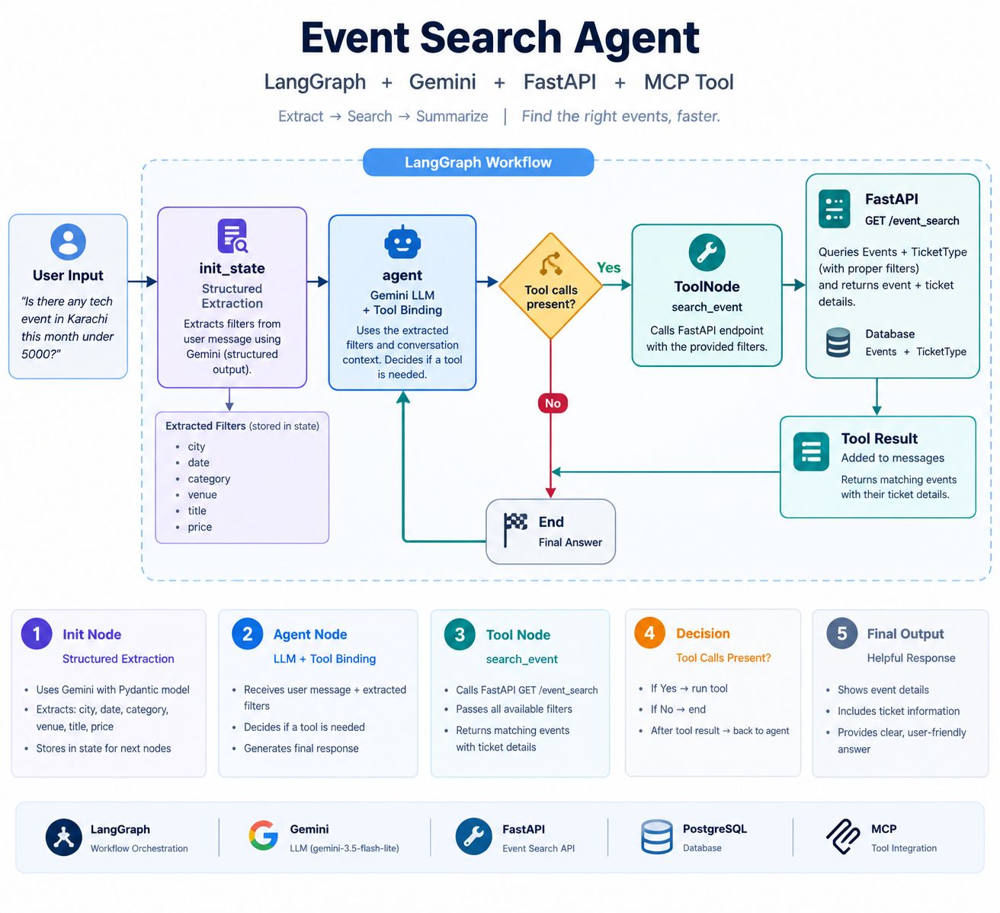

# TicketFlow

TicketFlow is an event ticket booking REST API built with FastAPI and PostgreSQL. It supports organizer-managed events, ticket categories, customer bookings, and an AI-powered assistant for event discovery and policy questions.

A core focus is booking concurrency: when multiple customers try to book the last available seat at the same time, database row locking helps ensure that the seat is not sold twice.

## Features

### Authentication and access control
- Signup and login with JWT access tokens
- Bcrypt password hashing
- Organizer and customer roles
- Permission checks on protected routes

### Event and ticket management
- Organizers can create, update, publish, and delete their own events
- Events include title, venue, city, category, date, and status
- Events can have multiple ticket types, such as VIP and General
- Ticket types track price, total seats, and available seats

### Booking and payments
- Booking operations run inside database transactions
- `SELECT ... FOR UPDATE` locks the relevant ticket-type row during booking
- Returns `409 Conflict` when there are not enough seats
- New bookings start as pending and have an expiry time
- Cancelling or expiring a booking restores the reserved seats
- Mock payment changes a booking to confirmed; no real payment gateway is connected
- Booking items store the purchase-time unit price so later ticket price changes do not alter existing bookings

### AI event search agent
TicketFlow includes a natural-language event search agent built with LangGraph and Gemini.

A user can ask a question such as:

> Is there any tech event in Karachi this month under 5000?

The agent:
1. Extracts search filters such as city, date, category, venue, title, and price using structured output.
2. Stores the extracted filters in LangGraph state.
3. Uses a Gemini model with tool calling to decide when to search.
4. Calls the `search_event` tool, which sends the filters to the FastAPI `GET /event_search` endpoint.
5. Receives matching event and ticket information and uses it to formulate a natural-language response.

The search tool queries event and ticket-type data through the API. The event-search endpoint must be running and reachable by the agent.

**Important:** The current agent code uses LangChain's `@tool` decorator and LangGraph's `ToolNode`. It does not expose a standalone MCP server yet. MCP integration can be added separately if you want external MCP clients to access the search tool.

### AI policy assistant
`POST /ask` answers customer questions using retrieval-augmented generation (RAG) over `TicketFlow_Policies.pdf`.

- Splits the policy PDF into chunks
- Creates embeddings with Mistral
- Stores and retrieves chunks using ChromaDB
- Returns an answer with source page numbers
- Should respond that it does not know when the policy does not support an answer

The policy assistant needs a Mistral API key. Tests mock Mistral calls, so a real key should not be needed for the test suite.

### Other features
- Organizer sales and seat reports
- PostgreSQL migrations with Alembic
- Tests with pytest
- Redis integration
- Docker and Docker Compose
- GitHub Actions workflow for Docker image builds and publishing

## Tech stack

| Area | Tools |
|---|---|
| Language | Python |
| API | FastAPI, Uvicorn |
| Database | PostgreSQL, SQLAlchemy, psycopg2 |
| Migrations and validation | Alembic, Pydantic |
| Authentication | JWT (`python-jose`), bcrypt |
| Cache | Redis |
| Agent orchestration | LangGraph |
| LLM and tool calling | Gemini through `langchain-google-genai`, LangChain Core |
| Policy RAG | Mistral AI, ChromaDB, LangChain text splitters, pypdf |
| HTTP client | HTTPX |
| Testing | pytest |
| DevOps | Docker, Docker Compose, GitHub Actions, Docker Hub |
| Configuration | python-dotenv |

## Architecture

```text
Client
  |
  v
FastAPI
  |
  +--> Routers --> Schemas --> Services
  |                  |
  |                  +--> PostgreSQL
  |                  +--> Redis
  |
  +--> GET /event_search <--- LangGraph Event Search Agent
  |                              |
  |                              +--> Structured filter extraction
  |                              +--> Gemini agent with tool calling
  |                              +--> search_event tool (HTTPX)
  |
  +--> POST /ask
         |
         +--> Policy PDF --> Chunking --> Mistral embeddings
                                           |
                                           v
                                        ChromaDB
                                           |
Question --> Retrieval --> Mistral chat model --> Answer + source pages
```

## Data model

```text
User 1:N Event
User 1:N Booking
Event 1:N TicketType
Event 1:N Booking
Booking 1:N BookingItem
TicketType 1:N BookingItem
Booking 1:1 Payment
```

| Model | Example fields |
|---|---|
| User | `name`, `email`, `password_hash`, `role` |
| Event | `organizer_id`, `title`, `venue`, `city`, `category`, `starts_at`, `status` |
| TicketType | `event_id`, `name`, `price`, `total_seats`, `available_seats` |
| Booking | `customer_id`, `event_id`, `status`, `total_amount`, `expires_at` |
| BookingItem | `booking_id`, `ticket_type_id`, `quantity`, `unit_price` |
| Payment | `booking_id`, `amount`, `status`, `paid_at` |

`BookingItem.unit_price` preserves the price at purchase time.

## How double booking is prevented

A naive booking flow can allow two requests to read the same final available seat before either request updates the database.

TicketFlow protects the booking operation with a database transaction:

1. Lock the relevant `TicketType` row using `with_for_update()`.
2. Check that enough seats remain.
3. Return `409 Conflict` if the requested quantity is unavailable.
4. Decrease the available seat count and create the booking.
5. Commit the transaction and release the lock.

A concurrent request for the same row waits for the first transaction to finish, then checks the updated seat count.

## API overview

Interactive API documentation is available at `/docs` after the API starts.

| Group | Routes |
|---|---|
| Authentication | `POST /auth/register`, `POST /auth/login`, `GET /auth/me` |
| Events | `GET /events`, `GET /events/{id}`, `POST /events`, `PATCH /events/{id}`, `DELETE /events/{id}`, `POST /events/{id}/publish` |
| Ticket types | `GET /events/{id}/ticket-types`, `POST /events/{id}/ticket-types`, `PATCH /ticket-types/{id}` |
| Bookings | `POST /bookings`, `GET /bookings`, `GET /bookings/{id}`, `POST /bookings/{id}/pay`, `POST /bookings/{id}/cancel` |
| Reports | `GET /events/{id}/sales` |
| Event search | `GET /event_search` |
| Policy assistant | `POST /ask` |
| Health | `GET /health` |

## Example: natural-language event search

The agent accepts a natural-language request and extracts supported filters before calling the search tool.

Example request:

```text
Is there any tech event in Karachi this month under 5000?
```

The agent can extract values such as:
- City: Karachi
- Date: this month
- Title or category: tech
- Maximum ticket price: 5000

The search tool calls the API endpoint:

```http
GET /event_search?city=Karachi&price=5000
```

The endpoint should return matching event and ticket details. The agent then uses the tool result to generate a user-friendly response. Results depend on the data stored in the database; the agent should not be treated as a source of live event information unless the search tool has returned data.

## Example: policy assistant

Request:

```http
POST /ask
Content-Type: application/json
```

```json
{
  "question": "How long do refunds take?"
}
```

Example response shape:

```json
{
  "answer": "The answer based on the configured policy...",
  "sources": [2, 3]
}
```

The `sources` array contains policy PDF page numbers. The exact answer depends on the contents of `TicketFlow_Policies.pdf`.

The policy index is built on the first `/ask` request and stored in `chroma_db/`. This directory should remain git-ignored. Delete it to rebuild the index.

## Run locally

### Option 1: Docker Compose

```bash
git clone https://github.com/AdeiaSaif/TicketFlow.git
cd TicketFlow
cp .env.example .env
```

Fill in the required values in `.env`, then run:

```bash
docker compose up --build
```

Configured service addresses:

| Service | Address |
|---|---|
| API docs | `http://localhost:8000/docs` |
| PostgreSQL | `localhost:5435` |
| Redis | `localhost:6380` |
| pgAdmin | `http://localhost:5050` |

These ports depend on your `docker-compose.yml` configuration.

### Option 2: Python environment

Create and activate a virtual environment, then install dependencies:

```bash
python -m venv .venv
source .venv/bin/activate
python -m pip install -r requirements.txt
```

Create your `.env` file using the variables below, run database migrations, and start the API using your project's configured ASGI import path. For example, if the FastAPI instance is `app` in `main.py`:

```bash
alembic upgrade head
uvicorn main:app --reload
```

Run the event-search agent from the Python file where its graph is defined, after the API is running.

## Environment variables

Create a `.env` file and never commit real secrets:

```env
SECRET_KEY=replace-with-a-long-random-secret
ALGORITHM=HS256
DATABASE_URL=postgresql+psycopg2://postgres:<password>@localhost:5435/ticketflow
REDIS_URL=redis://localhost:6380/0
MISTRAL_API_KEY=your-mistral-api-key
GOOGLE_API_KEY=your-google-api-key
```

The Google API key is required by the Gemini-powered event search agent. The Mistral API key is required by the RAG policy assistant.

Generate a secret key:

```bash
python -c "import secrets; print(secrets.token_urlsafe(48))"
```

**Agent connection note:** The sample agent calls `http://0.0.0.0:8000/event_search`. `0.0.0.0` is generally used as a server bind address, not as a client destination. When running the agent on the same host as the API, use `http://127.0.0.1:8000/event_search`. When running it in another Docker container, use the API service name from `docker-compose.yml`, for example `http://api:8000/event_search` if the service is named `api`.

## Database migrations

```bash
alembic upgrade head
```

## Run tests

```bash
pytest -v
```

## CI/CD

The GitHub Actions workflow builds the Docker image on pushes to `main` and publishes it to Docker Hub, according to the workflow configuration.

## Roadmap

- [ ] Run the test suite in CI before building the image
- [ ] Add concurrency load tests for simultaneous booking requests
- [ ] Deploy the API to a public server
- [ ] Extend the AI agent to support event discovery and booking workflows
- [ ] Add an MCP server if external MCP clients need access to event-search tools
- [ ] Build a React frontend

## Author

**Adeia Saif** · [LinkedIn](#) · [GitHub](https://github.com/AdeiaSaif)
